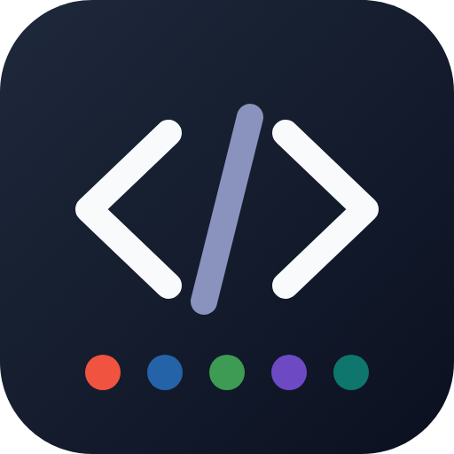

<p align="center">
  
</p>

# php-dev-tools

[![CI][ci-badge]][ci]
[![Release][release-badge]][releases]
[![Packagist][packagist-badge]][packagist]
[![PHP][php-badge]][packagist]
[![License][license-badge]][license]
[![Docs][docs-badge]][docs]

The quality settings of the zairakai PHP projects, without Laravel: the Pint, PHPStan, Rector, PHP Insights and markdownlint configurations, with the thin files for the editor, as a base that a project extends. It has no command and no hook: they are in [`zairakai/laravel-dev-tools`](https://packagist.org/packages/zairakai/laravel-dev-tools).

## The principle

A project does not copy the rules of the tools. It has its own small configuration files, which **extend** the rules that live in `vendor/`. The rules are then always the ones of the installed version of this package, and the project only writes what is specific to it: an exclusion that is justified, a path, a rule it changes.

| File of the project | What it does |
| :--- | :--- |
| `pint.json` | A copy of the base file: Pint cannot extend another file, and the editor reads this one. A test checks that the copy is identical to the base. |
| `phpstan.neon` | `includes` the base file, then sets the paths and the ignored errors of the project. |
| `rector.php` | Calls `Rector::configure()` with the version of PHP and the directories. |
| `phpinsights.php` | Calls `Insights::config()` with the overrides of the project. |
| `.markdownlint.json` | `extends` the base file. |
| `.markdownlintignore` | The paths that the editor skips when it lints the Markdown files. |

## Documentation

The [documentation site][docs] has this guide and the reference of every class, read from the source, for each released version (selector at the top right, `next` is `main`). Build it with `cd docs && npm ci && npm run dev`.

## Requirements

PHP 8.4 or higher, like `zairakai/laravel-dev-tools`.

## Installation

```sh
composer require --dev stanislas-poisson/php-dev-tools
composer config allow-plugins.dealerdirect/phpcodesniffer-composer-installer true
```

PHP Insights needs the `dealerdirect/phpcodesniffer-composer-installer` plugin: the second command allows it.

Then copy the thin files of `stubs/` to the root of the project. Never replace a file that the project already has:

```sh
cp -n vendor/stanislas-poisson/php-dev-tools/stubs/{pint.json,phpstan.neon,rector.php,phpinsights.php} .
cp -n vendor/stanislas-poisson/php-dev-tools/stubs/{.markdownlint.json,.markdownlintignore} .
```

The commands, the Git hooks and the `make` targets are not in this package: they come with `zairakai/laravel-dev-tools`, or with the package for the projects without Laravel when it exists.

## Extending the base

<details>
<summary>Configuration examples for each tool</summary>

### Pint

Pint cannot extend another file, and the editor reads only the `pint.json` of the project. So the `pint.json` of a project is a **copy** of `config/pint.json`, the file of this package (`stubs/pint.json` is the same file). The editor then applies the rules without any setting.

The copy is brought up to date when this package changes, and checked against the base: the command that does it comes with the package of the commands. A project that has to change a rule keeps its changes apart, and the copy is generated from the base and from them. Here is the format that `Pint::merge()` understands: its `rules` replace the ones of the base by name, and the `exclude` of its `finder` is added to the one of the base (`build` and `vendor` are always excluded):

```json
{
  "rules": {
    "yoda_style": false
  },
  "finder": {
    "exclude": ["data"]
  }
}
```

`Pint::write($root)` merges the base and the file of the project, and writes the result in `build/pint.json`.

### PHPStan

```neon
includes:
    - vendor/stanislas-poisson/php-dev-tools/config/phpstan.neon

parameters:
    paths:
        - src
        - tests
```

### Rector

```php
use StanislasPoisson\DevTools\Rector;

return Rector::configure(__DIR__, php: '8.4')
    ->withSkip([SomeRector::class => [__DIR__ . '/src/Entity']]);
```

`Rector::configure()` returns the builder of Rector, with the sets of `laravel-dev-tools` for the version of PHP and without the Laravel ones. The directories are `src` and `tests`, and the ones that do not exist are left out.

### PHP Insights

```php
use StanislasPoisson\DevTools\Insights;

return Insights::config([
    'exclude' => ['config/reference.php'],
    'config'  => [
        SomeSniff::class => ['exclude' => ['src/Models']],
    ],
]);
```

The lists `remove` and `exclude` are added to the ones of the base. The keys of `add`, `config` and `requirements` replace the ones of the base. Any other key replaces the base. The base asks for 100 % everywhere, and removes the rules that contradict Pint.

A file must not be excluded to hide an error: write why next to each exclusion.

### markdownlint

```json
{
  "extends": "./vendor/stanislas-poisson/php-dev-tools/config/.markdownlint.json"
}
```

</details>

## Known limits

- **The tools come with this package**: a project cannot choose their version.
- **The thin files are copied by hand**: nothing creates them any more, and nothing runs the tools: the scripts of `composer.json` are written by the project.

## Versioning

The package follows [Semantic Versioning](https://semver.org/). Require it with `^2.0`.

**A major version** changes what a project writes or calls:

- `Rector::configure()`, `Insights::config()` and `Pint::write()`, with the keys that `Insights::config()` merges and how the `pint.json` of a project is merged,
- the names of the thin files of `stubs/`,
- the paths of the base files in `vendor/` that a project includes or extends,
- the lowest version of PHP.

**A minor version** can add an option, and **can add or tighten a rule** of the base, or raise the version of a tool: a project that was green can turn red. The release notes list these changes, and a project that does not want to follow can keep the version it has.

**A patch version** fixes a defect without changing what the tools ask for.

## Development

```sh
composer install
composer quality   # the package passes its own tools
```

See [CONTRIBUTING.md](CONTRIBUTING.md) for the details.

## Roadmap

1. The configurations ([#3](https://github.com/Stanislas-Poisson/php-dev-tools/issues/3)), the community files ([#2](https://github.com/Stanislas-Poisson/php-dev-tools/issues/2)) and the first stable version, `1.0.0`: done.
2. The settings alone, like `js-dev-tools`: the command, the hooks and the Makefile leave for a package of the commands.
3. A package of the commands for the projects without Laravel (KMark, PPTX-Enigma and French-Postal-Code-Package).

## Statistics

![Statistics of php-dev-tools][stats-card]

## License

[MIT](LICENSE). Copyright (c) 2026 Stanislas Poisson.

[ci-badge]: https://img.shields.io/github/actions/workflow/status/Stanislas-Poisson/php-dev-tools/ci.yml?branch=main&label=CI
[ci]: https://github.com/Stanislas-Poisson/php-dev-tools/actions/workflows/ci.yml
[release-badge]: https://img.shields.io/github/v/release/Stanislas-Poisson/php-dev-tools
[releases]: https://github.com/Stanislas-Poisson/php-dev-tools/releases
[packagist-badge]: https://img.shields.io/packagist/v/stanislas-poisson/php-dev-tools
[packagist]: https://packagist.org/packages/stanislas-poisson/php-dev-tools
[php-badge]: https://img.shields.io/packagist/dependency-v/stanislas-poisson/php-dev-tools/php
[license-badge]: https://img.shields.io/github/license/Stanislas-Poisson/php-dev-tools
[license]: LICENSE
[docs-badge]: https://img.shields.io/badge/docs-online-blue
[docs]: https://stanislas-poisson.github.io/php-dev-tools/
[stats-card]: https://raw.githubusercontent.com/Stanislas-Poisson/Stanislas-Poisson/main/assets/projects/php-dev-tools.svg
